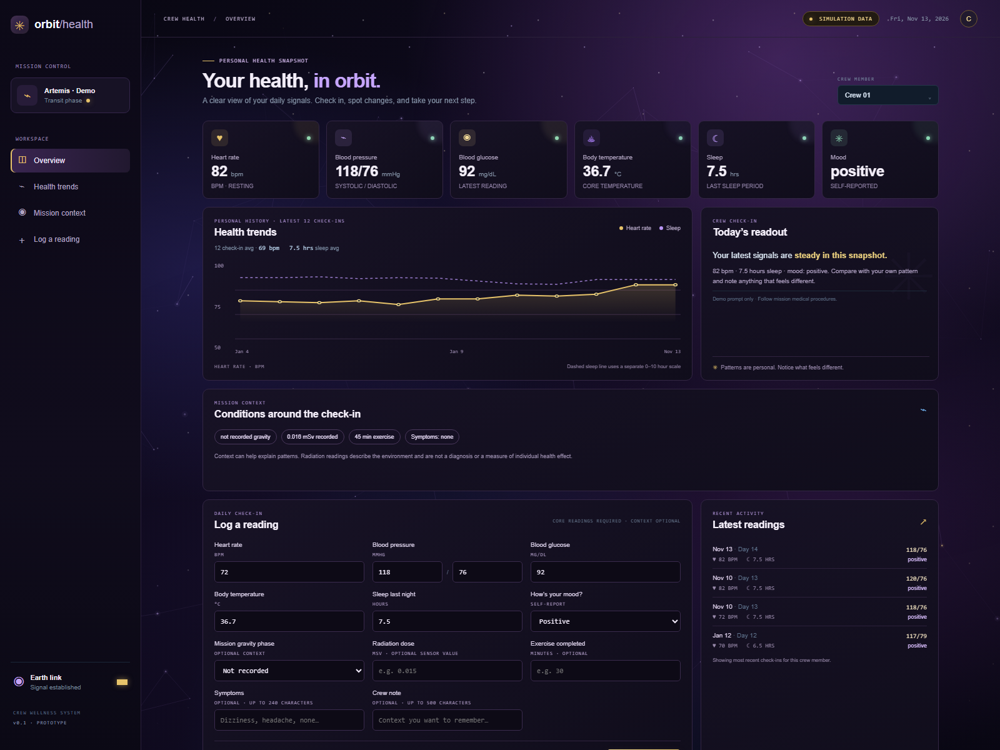

# Orbit Health

### A crew wellness dashboard concept for long-duration space missions

Orbit Health is a local, desktop-style prototype that helps a crew member log a daily wellness check-in, review personal trends, and see mission context alongside health indicators. The interface uses a quiet, space-inspired visual design so key readings and next steps are easy to scan.

> **Prototype notice:** Orbit Health is a hackathon demonstration, not a medical device or clinical decision tool. All bundled records are fictional. Example bands and prompts are illustrative, not validated flight-medicine guidance. Follow approved mission medical procedures for real health concerns.



*Dashboard preview with fictional Crew 01 data. Start the local app to try the check-in form and interactive trends.*

## Demo

The app runs locally so reviewers can interact with the dashboard and save a check-in. Follow the [quick start](#quick-start) to launch it. For a short presentation, see the [demo walkthrough](demo/DEMO_WALKTHROUGH.md), which is designed to fit a 30-second recording or a brief live demonstration.

## What you can do

- Select a fictional crew member and review their latest health snapshot.
- Explore recent heart-rate and sleep trends, with a personal baseline summary.
- Compare readings with mission context such as gravity phase, exercise, and optional radiation-sensor input.
- Enter a new check-in with blood pressure, heart rate, glucose, temperature, sleep, mood, symptoms, and an optional crew note.
- Save the check-in to the local CSV and see it appear in the recent activity and trends.
- Receive simple, illustrative prompts when a reading falls outside the prototype's demo reference bands.

## Quick start

### Requirements

- Windows 10/11
- [Node.js](https://nodejs.org/) 18 or newer (LTS recommended)
- Microsoft Edge for the optional desktop-style launcher

### Run the web app

1. Download or clone this repository.
2. Open PowerShell in the project folder.
3. Run `npm start`.
4. Open <http://localhost:3000> in a browser.

On Windows, you can also double-click `Start_Orbit_Health.bat`. To open the app in an Edge app-style window, double-click `Open_Orbit_Health_Desktop.bat`. Keep the project folder in place while using either launcher; the backend reads and updates the CSV inside `data/`.

This is a local Node.js app, not a standalone `.exe`. The app needs the server running; opening the HTML file directly with `file://` will not connect to the API.

## How to try the demo

1. Start the app and select a crew member.
2. Review the health cards, trend chart, and mission-context panel.
3. Scroll to **Log a reading** and adjust one or more values.
4. Select **Save check-in**.
5. Confirm the new record appears in **Latest readings** and updates the visible trends.

See [`demo/DEMO_WALKTHROUGH.md`](demo/DEMO_WALKTHROUGH.md) for suggested narration and a recording shot list.

## How it works

```text
Browser dashboard
  ├─ GET /api/records        loads sample and saved readings
  ├─ POST /api/records       validates and saves a check-in
  └─ GET /api/health         reports local API status
           │
           ▼
Node.js HTTP server ──► data/synthetic_astronaut_health_records.csv
```

The prototype uses plain HTML, CSS, and JavaScript in the frontend and Node.js built-in modules in the backend. It has no external runtime packages or account requirement. New records are appended to the local CSV; use the repository's original CSV to restore the initial demo data.

## Project map

| Path | Purpose |
| --- | --- |
| `frontend/astronaut_health_dashboard.html` | Dashboard structure and check-in form |
| `frontend/astronaut_health_dashboard.css` | Responsive layout, colors, animations, and galaxy background |
| `frontend/astronaut_health_dashboard.js` | API calls, chart rendering, interactions, and form submission |
| `backend/health_records_api.js` | Local HTTP API, input validation, and CSV persistence |
| `data/synthetic_astronaut_health_records.csv` | Fictional example readings, updated by saved check-ins |
| `data/data_dictionary.md` | Field descriptions, units, and data provenance |
| `data/nasa_csa_research_references.md` | NASA and Canadian Space Agency background sources |
| `demo/DEMO_WALKTHROUGH.md` | Short demo script and recording checklist |
| `Start_Orbit_Health.bat` | Windows browser launcher |
| `Open_Orbit_Health_Desktop.bat` | Windows Edge app-style launcher |

## Data, science, and scope

NASA Human Research Program materials describe five hazards of human spaceflight and related health risks. These informed the dashboard's focus on routine self-checks, trends, wellbeing, and mission context. Canadian Space Agency materials inform the optional radiation-context field and the role of space research in preparing for longer missions. Read the complete [source list](data/nasa_csa_research_references.md).

The bundled CSV is **synthetic example data**, not a NASA dataset, astronaut record, or clinical training set. Entries created in the app are user-entered demonstration records and are stored locally without authentication or encryption. Do not enter real personal health information.

The app does not connect to a wearable, phone health platform, spacecraft sensor, or flight surgeon. Radiation is contextual environmental input and does not diagnose an individual effect. Trends are descriptive; they do not prove a cause. Example ranges and generated prompts are simplified for interface demonstration and must not guide real treatment.

## API overview

- `GET /api/health` — local server status.
- `GET /api/records?astronaut=CREW-01&limit=12` — recent records and crew IDs.
- `POST /api/records` — validate and append a check-in. Required fields are listed in the [data dictionary](data/data_dictionary.md).

The API is intended for local demonstration and is not hardened for internet exposure or multi-user deployment.

## Credits and tools

- **Challenge:** 2026 NASA Space Apps Challenge, “Create Health Monitoring Software for Astronauts on Space Missions.”
- **Research references:** NASA Human Research Program and Canadian Space Agency; see [`data/nasa_csa_research_references.md`](data/nasa_csa_research_references.md).
- **AI tools used:** Claude for early project-detail exploration; OpenAI Codex/ChatGPT for implementation assistance.

NASA and CSA are cited as sources of background information. This project is an independent prototype and is not endorsed by or affiliated with NASA or the Canadian Space Agency.

## License

This repository is released under the MIT License. See [`LICENSE`](LICENSE).
